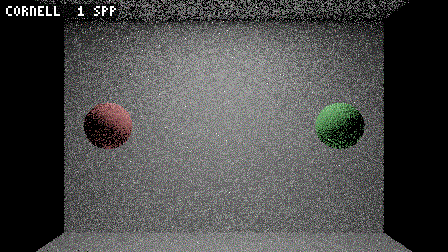
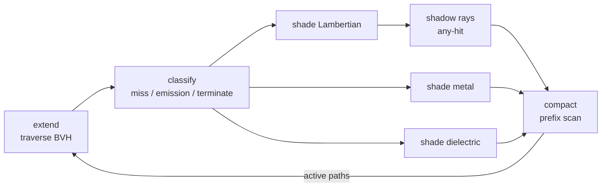
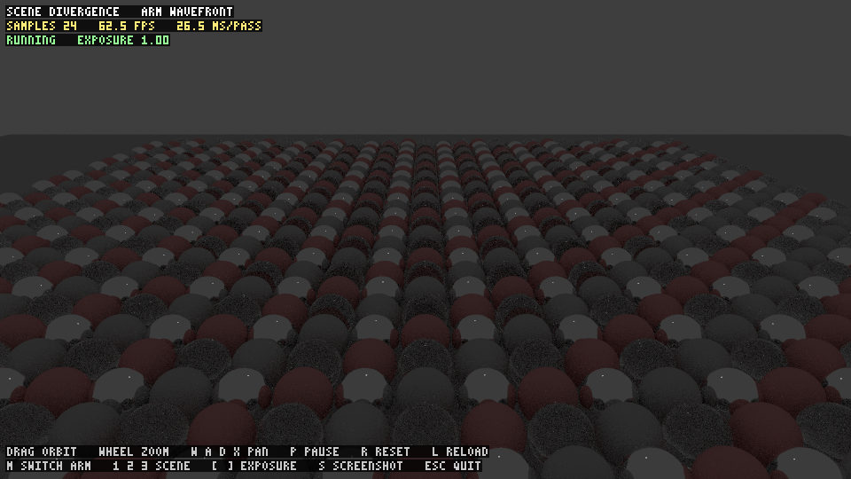
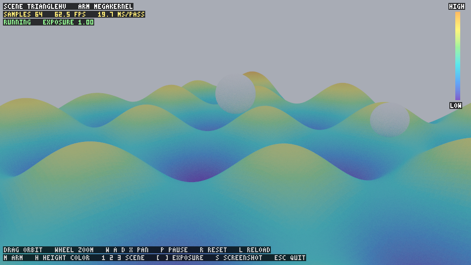

# graphics-book-tutorials

Worked studies in GPU and real-time graphics: each project takes an idea from the literature, implements it from scratch in C++20/CUDA (and Vulkan where it helps), tests it, and measures it on real hardware, including the results that do not go the way the paper says. More projects will be added over time.

| Project | Topic | Status |
|---|---|---|
| [`wavefront-vs-megakernel-path-tracing`](wavefront-vs-megakernel-path-tracing/) | Queue-based wavefront versus single-kernel path tracing on a laptop GPU, with a CPU reference, a Vulkan viewer, and nine statistical analyses of the code | complete |

---

# Project 1: wavefront versus megakernel path tracing

<p align="center">
  
</p>
<p align="center"><sub>Real renders of the three benchmark scenes, 1 to 256 samples per pixel (`tools/wfgif.cpp`). The hills are coloured by height; the benchmark scene itself is grey.</sub></p>

A path tracer in C++20/CUDA with three arms that share one estimator: a multi-threaded **CPU reference**, a **megakernel** (one thread per pixel, the whole path in one kernel), and a **wavefront** engine (stages split by material with queues, prefix-sum compaction and warp-aggregated pushes, written from scratch). The question, fixed before measuring: *is the wavefront at least 30% faster than the megakernel on a material-divergent scene, at 1280x720 on a GTX 1650 Ti within 3.5 GB?*

**Answer: no.** The wavefront was slower on all three scenes (0.46x to 0.69x). The repository documents why, with counters, models and statistics rather than speculation.

## Key results

Measured on an NVIDIA GeForce GTX 1650 Ti (compute capability 7.5, 4 GB), CUDA 12.9, 1280x720, 64 samples per pixel, depth 8, seed 1234, 2 warm-up and 5 timed runs per condition (raw files: [`results/bench-*.json`](wavefront-vs-megakernel-path-tracing/results)).

| Scene | Megakernel median (p10 to p90) | Wavefront median (p10 to p90) | Speedup (target 1.30) | Verdict |
|---|---|---|---|---|
| cornell | 447.3 ms (409.8 to 449.6) | 965.4 ms (948.2 to 969.9) | **0.46** | hypothesis weakened |
| divergence | 1060.6 ms (1056.6 to 1064.9) | 1585.3 ms (1551.3 to 1632.6) | **0.67** | hypothesis weakened |
| trianglehv | 2141.5 ms (2134.6 to 2185.7) | 3118.9 ms (2984.6 to 3276.0) | **0.69** | hypothesis weakened |

- All quality gates pass on every scene: megakernel and wavefront agree bitwise; the CPU reference agrees with both on 99.9% of pixels within three standard errors; zero queue overflows, invalid hits or non-finite pixels.
- Peak device memory is far inside the 3.5 GB budget (42 to 54 MB megakernel, 490 to 504 MB wavefront).
- The verdict is *hypothesis weakened* on every scene. Run-to-run spread is real (relative spread of the five runs: megakernel 0.8% to 8.9%, wavefront 2.3% to 9.3%).
- This is a negative result for **this implementation on this GPU**, not a proof about the paradigm. The wavefront here synchronises with the host after every bounce and moves per-path state through global memory; a persistent-threads or fused design could behave differently.

| Why the wavefront lost (Nsight Compute, divergence, 1 spp) | Megakernel | Wavefront |
|---|---|---|
| total kernel time | 16.0 ms | 19.5 ms |
| warp lane efficiency (active lanes / 32) | 0.27 | 0.38 |
| DRAM throughput (kernel-time weighted) | 1% | 41% to 56% in classify and shading |
| share of its time left of the roofline ridge point | right of it (compute side) | 95% of kernel time left of it (memory side) |

Shading divergence is fixed (30 of 32 lanes active in the material kernels), but traversal stays as divergent as before and every bounce now reads and writes path state in DRAM. Sections below show the evidence.

## What was built

- **Shared estimator** ([`include/wf/path_core.hpp`](wavefront-vs-megakernel-path-tracing/include/wf/path_core.hpp)): every step of the path tracer is a small inline function compiled for host and device; no arm contains its own copy of the shading logic.
- **Counter-based RNG**: each draw is a pure function of (seed, pixel, sample, depth, dimension), so execution order cannot change a path and the two GPU arms are comparable bit for bit.
- **BVH**: CPU-built binned-SAH tree in a preorder skip-link layout for stackless traversal, plus a brute-force oracle.
- **Wavefront engine** ([`src/gpu/wavefront.cu`](wavefront-vs-megakernel-path-tracing/src/gpu/wavefront.cu)): structure-of-arrays path state, material queues, scan and stream compaction from scratch ([`queues.cu`](wavefront-vs-megakernel-path-tracing/src/gpu/queues.cu)), overflow counters.
- **Benchmark driver** with a pre-registered verdict rule, versioned `report.json`, Nsight Compute and sanitizer wrappers.
- **Vulkan viewer** with progressive rendering, orbit camera, arm switching and screenshots.
- **Analysis tools**: nine statistical studies of the code (below), an SVG chart generator and a GIF encoder, all driven by real renders.
- **Tests**: custom-framework unit tests and Catch2 suites covering math, RNG, intersection, BVH, assets, CLI, reports, queues, both GPU arms, the benchmark rule and the tools.



One wavefront pass is one sample for every pixel; the loop above runs once per bounce. The megakernel runs the same functions in one loop per thread. Details: [`docs/implementation`](wavefront-vs-megakernel-path-tracing/docs/implementation/README.md).

## Mathematics behind the code

**Estimator.** A pixel value is the integral over light paths $\bar{x}$ of the measurement contribution $f$; the renderer averages $N$ independent samples

$$\hat{I}_N=\frac{1}{N}\sum_{i=1}^{N}\frac{f(\bar{x}_i)}{p(\bar{x}_i)},\qquad \mathrm{Var}[\hat{I}_N]=\frac{\sigma^{2}}{N},\qquad \mathrm{RMSE}=\frac{\sigma}{\sqrt{N}} .$$

**Lambertian scattering and next-event estimation.** With $f_r=\rho/\pi$ and cosine-weighted sampling ($p_\omega=\cos\theta/\pi$) the throughput is multiplied by $\rho$ per bounce. A light point sampled uniformly by area has solid-angle density $p_\omega=p_Ar^{2}/|\cos\theta_\ell|$, and the direct contribution is

$$L_{\mathrm{direct}}=T\frac{\rho}{\pi}\cos\theta\frac{L_ew_{\ell}}{p_\omega^{\ell}} .$$

**Multiple importance sampling** combines light sampling and BSDF sampling with the power heuristic ($\beta=2$):

$$w_a(x)=\frac{p_a(x)^{2}}{p_a(x)^{2}+p_b(x)^{2}} .$$

**Russian roulette** (from depth 3) keeps the estimator unbiased: with $q=\mathrm{clamp}\big(\max_c T_c,0.05,0.95\big)$ a path survives with probability $q$ and is reweighted $T\leftarrow T/q$.

**Furnace oracle.** In a closed furnace of albedo $\rho$ and emission $L_e$, truncating at maximum depth $D$ gives exactly the partial Neumann series

$$L_D=L_e\sum_{k=0}^{D}\rho^{k}\longrightarrow\frac{L_e}{1-\rho}\quad(D\to\infty),$$

which the three renderers must reproduce (Figure 2 below).

**SIMT efficiency model.** If a warp's 32 lanes draw materials independently with probabilities $p_i$, serialised branch execution has efficiency $\eta=1/\mathbb{E}[K]$ with

$$\mathbb{E}[K]=\sum_i\Big(1-(1-p_i)^{32}\Big),\qquad H=-\sum_i p_i\log_2 p_i .$$

**Cost model.** Render time grows linearly with pixel count $P$ (megapixels), $T_{\mathrm{arm}}(P)=\alpha+\beta P$, so the speedup tends to a limit set by the per-pixel costs

$$S(P)=\frac{\alpha_{\mathrm{mk}}+\beta_{\mathrm{mk}}P}{\alpha_{\mathrm{wf}}+\beta_{\mathrm{wf}}P}\xrightarrow{P\to\infty}\frac{\beta_{\mathrm{mk}}}{\beta_{\mathrm{wf}}} .$$

**Roofline.** Attainable throughput is $P_{\mathrm{att}}=\min\big(P_{\mathrm{peak}},B\cdot I\big)$ with arithmetic intensity $I$ (FLOP per DRAM byte), ridge point $I^{*}=P_{\mathrm{peak}}/B$ and $P_{\mathrm{peak}}=N_{\mathrm{SM}}\cdot 64\cdot 2\cdot f_{\mathrm{SM}}$; both roofs are read from profiler counters.

**Surface-area heuristic.** The expected cost of a BVH for a ray that hits the root box is

$$C=\sum_{n\in\mathrm{internal}}\frac{A(n)}{A(\mathrm{root})}+\sum_{l\in\mathrm{leaves}}\frac{A(l)}{A(\mathrm{root})}|l| .$$

**Variance concentration.** For per-pixel variances sorted ascending with Lorenz curve $\mathcal{L}(q)$, the Gini coefficient is $G=1-2\int_0^1\mathcal{L}(q)dq$. **Path survival:** $S_k=(E_k-E_{k-1})/N$ from extension-ray counts $E_d$ at depth cap $d$, with a geometric tail $S_k\approx S_{k_0}r^{k-k_0}$. **Avalanche test:** a bit-flip probability $\hat p$ from $n$ trials is scored as $z=(\hat p-\tfrac12)/\sqrt{1/(4n)}$.

## Visualizations

Every figure is drawn by the code in this repository from measurements it took itself (`tools/wfstats.cpp`, `tools/wfbench.cpp`, Nsight Compute counters) and is vector SVG: click a figure to see it at full size. The two-column layout shrinks the text; the full-size files are in [`docs/figures`](wavefront-vs-megakernel-path-tracing/docs/figures).

### Benchmark outcome

<table>
<tr>
<td width="50%"><a href="wavefront-vs-megakernel-path-tracing/docs/figures/timing.svg"></a><br><sub><b>Render time.</b> Median of 5 timed runs with p10 to p90 whiskers. Source: <code>results/bench-*.json</code>.</sub></td>
<td width="50%"><a href="wavefront-vs-megakernel-path-tracing/docs/figures/speedup.svg"></a><br><sub><b>Speedup</b> of the wavefront over the megakernel against the 1.30 target. Source: <code>results/bench-*.json</code>.</sub></td>
</tr>
<tr>
<td width="50%"><a href="wavefront-vs-megakernel-path-tracing/docs/figures/stages.svg"></a><br><sub><b>Where the wavefront time goes</b> per stage (instrumented run). Source: <code>results/stage-times.run.txt</code>.</sub></td>
<td width="50%"><a href="wavefront-vs-megakernel-path-tracing/docs/figures/analysis/fig-07-scaling.svg"></a><br><sub><b>Scaling law</b> T = α + β·P and the speedup limit. Source: <code>results/stats/stats.json</code> (<code>scaling</code>).</sub></td>
</tr>
</table>

### Estimator statistics

<table>
<tr>
<td width="50%"><a href="wavefront-vs-megakernel-path-tracing/docs/figures/analysis/fig-01-convergence.svg"></a><br><sub><b>Figure 1, convergence.</b> RMSE follows N^(−1/2) (slope -0.502 for N ≥ 16). Source: <code>stats.json</code> (<code>convergence</code>).</sub></td>
<td width="50%"><a href="wavefront-vs-megakernel-path-tracing/docs/figures/analysis/fig-02-bias.svg"></a><br><sub><b>Figure 2, bias.</b> Furnace test against Lₑ·Σρᵏ; residual at most 1.2e-03. Source: <code>stats.json</code> (<code>furnace</code>).</sub></td>
</tr>
<tr>
<td width="50%"><a href="wavefront-vs-megakernel-path-tracing/docs/figures/analysis/fig-03-variance.svg"></a><br><sub><b>Figure 3, variance.</b> Lorenz curves: Gini 0.92, 0.83 and 0.91; the top 1% of pixels hold 79%, 46% and 82% of the variance. Source: <code>stats.json</code> (<code>variance</code>).</sub></td>
<td width="50%"><a href="wavefront-vs-megakernel-path-tracing/docs/figures/analysis/fig-04-survival.svg"></a><br><sub><b>Figure 4, path survival.</b> Geometric tails (ratios 0.38, 0.62 and 0.20). Source: <code>stats.json</code> (<code>survival</code>).</sub></td>
</tr>
</table>

### Hardware behaviour

<table>
<tr>
<td width="50%"><a href="wavefront-vs-megakernel-path-tracing/docs/figures/analysis/fig-05-simt-efficiency.svg"></a><br><sub><b>Figure 5, SIMT efficiency.</b> Material-mix model against measured lane efficiency. Source: <code>stats.json</code> (<code>divergence</code>) and <code>results/profiles/stats</code>.</sub></td>
<td width="50%"><a href="wavefront-vs-megakernel-path-tracing/docs/figures/analysis/fig-06-roofline.svg"></a><br><sub><b>Figure 6, roofline.</b> Every kernel against roofs from profiler counters. Source: <code>results/profiles/stats</code>.</sub></td>
</tr>
</table>

### Data structures and random numbers

<table>
<tr>
<td width="50%"><a href="wavefront-vs-megakernel-path-tracing/docs/figures/analysis/fig-08-bvh.svg"></a><br><sub><b>Figure 8, BVH.</b> Leaf depths, child to parent area ratio and SAH cost. Source: <code>stats.json</code> (<code>bvh</code>).</sub></td>
<td width="50%"><a href="wavefront-vs-megakernel-path-tracing/docs/figures/analysis/fig-09-rng.svg"></a><br><sub><b>Figure 9, RNG.</b> Avalanche matrix, serial chi-square over 32 seeds, autocorrelation. Source: <code>stats.json</code> (<code>rng</code>).</sub></td>
</tr>
</table>

### Viewer

<table>
<tr>
<td width="50%"><br><sub>Divergence scene, megakernel, 24 samples (<code>wfviewer --selftest</code>).</sub></td>
<td width="50%"><br><sub>Divergence scene, wavefront, 24 samples: identical pixels, different cost.</sub></td>
</tr>
<tr>
<td width="50%"><br><sub>Hills scene (115k triangles) coloured by height, valleys darkest.</sub></td>
<td width="50%"></td>
</tr>
</table>

## Implementation details

| Topic | Where | Summary |
|---|---|---|
| Estimator | [`docs/implementation/estimator.md`](wavefront-vs-megakernel-path-tracing/docs/implementation/estimator.md) | steps per bounce, MIS, roulette, numerical choices (`--fmad=false`, offset epsilons) |
| Wavefront engine | [`docs/implementation/wavefront-engine.md`](wavefront-vs-megakernel-path-tracing/docs/implementation/wavefront-engine.md) | path state layout, queues, scan and compaction, overflow handling |
| BVH | [`docs/implementation/bvh.md`](wavefront-vs-megakernel-path-tracing/docs/implementation/bvh.md) | binned SAH, skip links, stackless loop, oracle |
| RNG | [`docs/implementation/rng.md`](wavefront-vs-megakernel-path-tracing/docs/implementation/rng.md) | counter-based design, key derivation, quality tests |
| Benchmarking | [`docs/implementation/benchmarking.md`](wavefront-vs-megakernel-path-tracing/docs/implementation/benchmarking.md) | protocol, verdict rule, report schema |
| Profiling | [`docs/implementation/profiling.md`](wavefront-vs-megakernel-path-tracing/docs/implementation/profiling.md) | Nsight Compute metrics, roofline derivation, sanitizers |
| Viewer | [`docs/implementation/viewer.md`](wavefront-vs-megakernel-path-tracing/docs/implementation/viewer.md) | host-staged Vulkan present, controls, camera model |
| Statistics | [`docs/implementation/analysis.md`](wavefront-vs-megakernel-path-tracing/docs/implementation/analysis.md) | the nine analyses: method, inputs, how to read each figure |
| Original design | [`docs/implementation/design.md`](wavefront-vs-megakernel-path-tracing/docs/implementation/design.md) | the pre-registered design and evaluation contract |

Production code is about 7,241 lines of C++/CUDA (headers, sources, tools and scripts, excluding tests and blank lines).

## How to reproduce

**Requirements.** A CUDA-capable NVIDIA GPU (the study used compute capability 7.5), CUDA toolkit 12.x, CMake 3.24 or newer, a C++20 compiler, and [Catch2](https://github.com/catchorg/Catch2) v3 for the Catch2 suites. Optional: Nsight Compute (`ncu`) for profiling, GLFW and the Vulkan loader for the viewer, `compute-sanitizer` for the sanitizer rows.

```bash
cd wavefront-vs-megakernel-path-tracing
cmake -S . -B build -DCMAKE_PREFIX_PATH=<catch2-install-prefix>
cmake --build build -j

# render one image with each arm
build/wf render --scene divergence --width 1280 --height 720 --spp 64 --seed 1234 \
    --mode wavefront --out out --report out.json

# run the tests (each executable is a separate process)
ctest --test-dir build --output-on-failure

# the benchmark protocol (bench/protocol.json) -> results/bench-<scene>.json
bash scripts/run_benchmarks.sh

# counters, sanitizers, analysis figures, animation
bash scripts/profile_ncu.sh && bash scripts/profile_stats.sh
bash scripts/run_sanitizers.sh
build/wfstats results/stats/stats.json
for f in results/profiles/stats/*.csv; do build/ncusum "$f" --out "${f%.csv}.summary.json"; done
build/svgstats docs/figures/analysis results/stats/stats.json results/profiles/stats
build/wfgif docs/media/three-scenes.gif
```

Fixed settings: 1280x720, 64 spp, depth 8, seed 1234 (see `bench/protocol.json`). Timing numbers depend on the GPU; the structure of the result (all three scenes below 1.30x, warp-efficiency and roofline pattern) is what to compare. The GPU arms are compiled with `--fmad=false` and the host with `-ffp-contract=off`, which is what makes the megakernel and wavefront images bitwise equal.

## Repository layout

```
wavefront-vs-megakernel-path-tracing/
  include/wf/   header-only estimator, math, RNG, scene, BVH, interfaces
  src/          scene, BVH build, CPU renderer, CLI, report, benchmark; src/gpu/ CUDA arms; src/viewer/
  tools/        wfbench, imgdiff, ncusum, wfstats, svgstats, svgplot, wfgif
  scripts/      benchmark, profiling, sanitizer and viewer wrappers
  tests/        unit tests (tests/*.cpp) and Catch2 suites (tests/catch/)
  results/      raw benchmark JSON, Nsight Compute exports, statistics, sanitizer logs
  docs/         implementation notes, figures, media, short technical report
```

## Limitations and caveats

- One GPU, one driver, one machine (a laptop GPU under WSL); clocks were not locked.
- Three scenes; the negative result is for this implementation, not for wavefront path tracing in general.
- ASan and UBSan cannot run the GPU modes under the WSL driver (they abort inside the driver); CPU mode runs clean and `compute-sanitizer` memcheck reports no errors on both GPU arms (`results/sanitizers.json`).
- Stage times (the stage chart) include synchronisation and are for proportions only.
- Figure 2: the three arms use the same random numbers, so their residuals coincide; this shows no arm-specific error, not three independent confirmations.
- Figure 9: the worst of 6144 avalanche cells is 4.5 standard errors (Bonferroni $p=0.05$): borderline and consistent with chance.
- The viewer's window path was verified for compilation and device enumeration on the build machine; its rendering loop was exercised offscreen.

## References

1. M. Pharr and G. Humphreys, *Physically Based Rendering: From Theory to Implementation*, Morgan Kaufmann, 2004 (first edition; estimator, Monte Carlo and light-transport chapters).
2. S. Laine, T. Karras, T. Aila, "Megakernels Considered Harmful: Wavefront Path Tracing on GPUs", *High-Performance Graphics (HPG)*, 2013.
3. T. Karras, "Maximizing Parallelism in the Construction of BVHs, Octrees, and k-d Trees", *HPG*, 2012.
4. A. Prokopenko and D. Lebrun-Grandie, "Revising Apetrei's bounding volume hierarchy construction algorithm to allow stackless traversal", arXiv:2402.00665, 2024.
5. D. Meister, J. Boksansky, M. Guthe, J. Bittner, "On Ray Reordering Techniques for Faster GPU Ray Tracing", *I3D*, 2020 (arXiv:2506.11273).
6. S. Shanmugavelu et al., "Impacts of floating-point non-associativity on reproducibility for HPC and deep learning applications", arXiv:2408.05148, 2024.
7. E. Veach and L. J. Guibas, "Optimally combining sampling techniques for Monte Carlo rendering", *SIGGRAPH*, 1995.
8. J. Arvo and D. Kirk, "Particle transport and image synthesis", *SIGGRAPH*, 1990 (Russian roulette).
9. J. K. Salmon, M. A. Moraes, R. O. Dror, D. E. Shaw, "Parallel random numbers: as easy as 1, 2, 3", *SC*, 2011.
10. S. Williams, A. Waterman, D. Patterson, "Roofline: an insightful visual performance model for multicore architectures", *Communications of the ACM* 52(4), 2009.
11. J. Goldsmith and J. Salmon, "Automatic creation of object hierarchies for ray tracing", *IEEE Computer Graphics and Applications* 7(5), 1987 (surface-area heuristic).
12. I. Wald, "On fast construction of SAH-based bounding volume hierarchies", *IEEE Symposium on Interactive Ray Tracing*, 2007 (binned SAH).
13. D. Padilla, J. Webster, J. Kim, "Megakernel vs Wavefront GPU Path Tracing", arXiv:2605.27323 (related work; consulted as a summary only, none of its results are used here).

## Licence

MIT, see [`LICENSE`](LICENSE).
